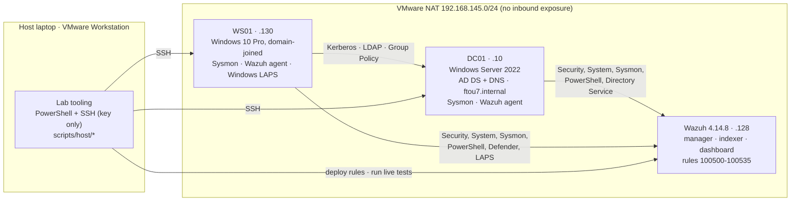
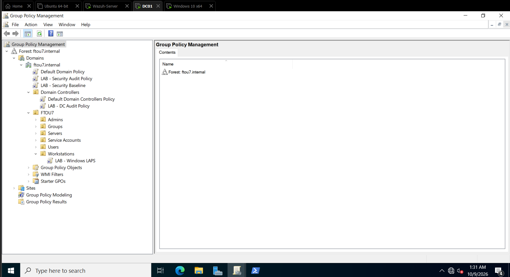
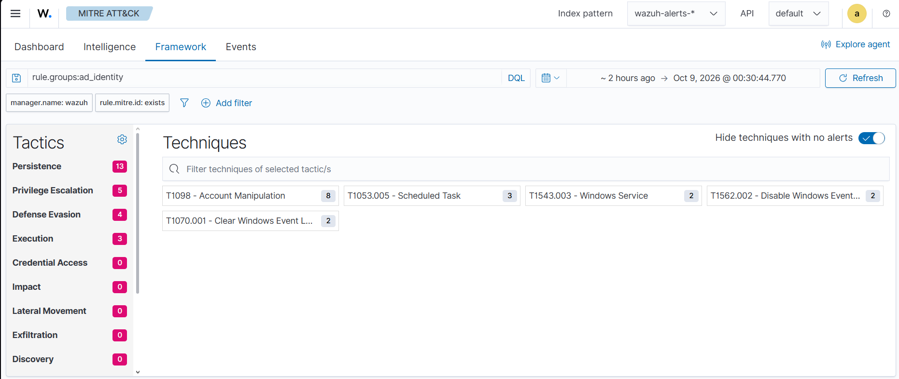
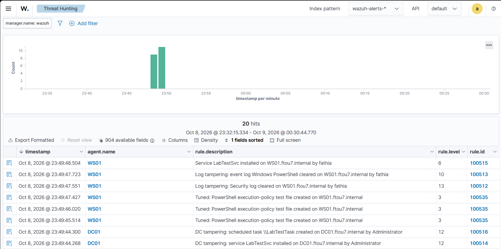
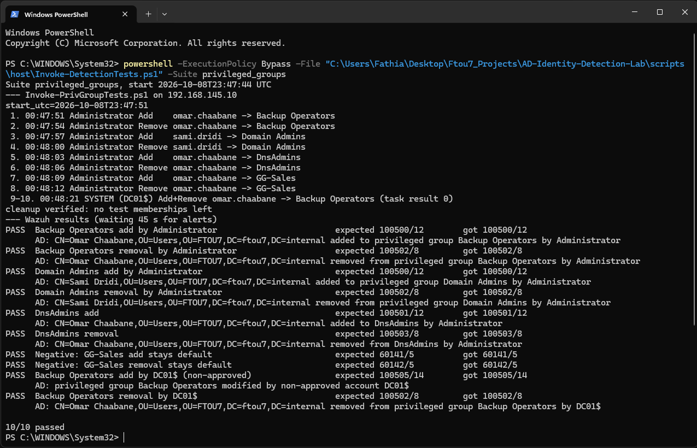
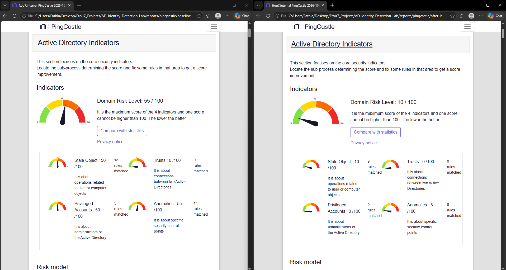
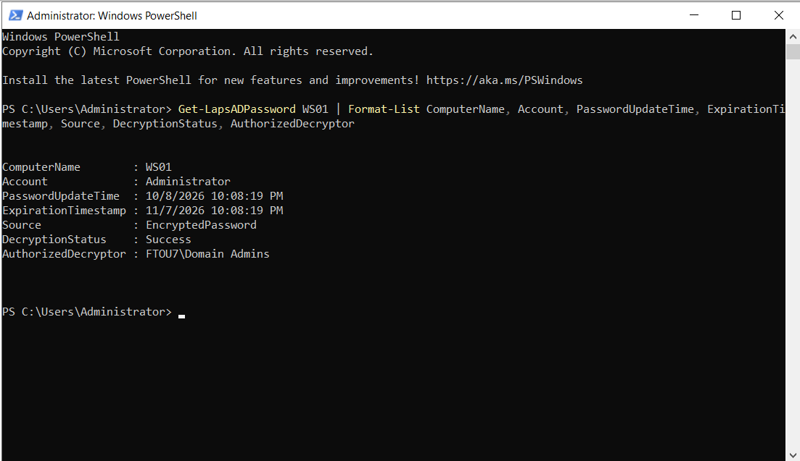

# AD Identity Detection Lab

A small, isolated Active Directory environment that sends Windows and Sysmon telemetry to **Wazuh**, with **custom detections for identity and domain-controller abuse**, each one **validated live** against real, reverted actions. The domain is then **hardened** from a PingCastle assessment, and the detections are re-tested after every change.

Everything is scripted, version-controlled and free to run (evaluation licences and open-source tools only).

| | |
|---|---|
| **Custom Wazuh rules** | 23 (17 detections + 6 false-positive tuning rules), mapped to MITRE ATT&CK |
| **Live detection tests** | 38, each a real action in the lab, including negative tests, all passing |
| **AD risk score (PingCastle)** | **55 → 10** (0 is best), privileged-group score 50 → 0 |
| **Telemetry problems found and fixed** | Audit policy mostly off, no object-creation events (missing SACL), DC clock ~7 h off, privilege auditing flooding ~30% of DC events |

---

## Architecture



**Group Policy** (all created by script): `LAB - Security Audit Policy` (23 audit subcategories, command-line and PowerShell logging), `LAB - DC Audit Policy` (DC-only privilege auditing), `LAB - Security Baseline` (NTLMv2 only, LLMNR off, hardened UNC paths, RemoteSigned), `LAB - Windows LAPS` (encrypted local-admin passwords in AD).



---

## Detections

Full catalogue, test tables and tuning notes: **[docs/detections.md](docs/detections.md)**. Rules: [`rules/ad_identity_rules.xml`](rules/ad_identity_rules.xml).

| Suite | Rules | What it catches | ATT&CK | Live tests |
|---|---|---|---|---|
| Privileged group changes | 100500–100505 | Member added to / removed from tier-0 groups (with member and actor), DnsAdmins, **changes by anyone outside the approved admins (matched by SID)** | T1098 | 10/10 |
| DC and logging tampering | 100510–100516 | Audit policy changed on a DC, Security or other logs cleared, services or scheduled tasks created on a DC | T1562.002, T1070.001, T1543.003, T1053.005 | 8/8 |
| Privileged account lifecycle | 100520–100525 | Accounts created in the Admins OU, admin accounts created, enabled or password-reset, built-in Administrator enabled or reset | T1136.002, T1098 | 9/9 |
| False-positive tuning | 100530–100535 | Re-ranks proven-benign Windows behaviour (per-user services, Defender updates, servicing tasks, LAPS rotation, PowerShell test files) **without silencing anything** | — | 11/11 |

An ATT&CK Navigator layer of the covered techniques is in [`docs/attack-layer.json`](docs/attack-layer.json).





More screenshots: [agents](docs/screenshots/01-agents.png) · [level-14 alert, change by a non-approved account](docs/screenshots/03-alert-detail.png) · unfiltered MITRE views ([dashboard](docs/screenshots/04b-mitre-all-alerts.png), [framework](docs/screenshots/04c-mitre-framework-all-alerts.png)), which show how much of a SIEM's volume comes from default mappings of normal activity.

**Design principles**

- **Extend the defaults, don't compete with them.** Wazuh already ships ~40 privileged-group rules; the custom rules build on the most specific default (`if_sid`) and add what's missing: add vs remove, member, actor, context.
- **Every detection has a negative twin.** Each suite proves that ordinary activity stays at the default level, and every tuning rule proves the suspicious variant still alerts at full severity.
- **Tune by re-ranking, never by deleting.** No rule is set to level 0. Benign patterns get their own low-level rule ID, so they stay searchable, and each exclusion requires several fields to match.
- **Fix the tool, not the rule.** When the lab's own automation tripped Sysmon's "base64-encoded PowerShell" rule, the automation was changed; the rule was left intact and is still tested.

### How the rules are tested

`wazuh-logtest` cannot decode Windows Event Channel events, so every rule is tested **live**: a script performs the real, harmless action on a VM and reverts it, then a checker on the Wazuh server compares the resulting alerts with the expected rule and level.

```powershell
# from the repo root on the host
.\scripts\host\Invoke-DetectionTests.ps1 -Suite privileged_groups   # or dc_tampering, account_changes, fp_tuning
```



---

## Hardening

Details: **[docs/hardening.md](docs/hardening.md)**.

| PingCastle (0 best, 100 worst) | Baseline | After hardening | After patching + LAPS |
|---|---|---|---|
| **Global** | 55 | 20 | **10** |
| Privileged groups | 50 | 0 | 0 |
| Stale objects | 50 | 10 | 10 |
| Anomalies | 55 | 20 | 5 |



Highlights: admin accounts not delegable and in Protected Users, Schema Admins empty, AD Recycle Bin on, 14-character minimum (20 for service accounts via a fine-grained policy), AES-only service accounts, no machine-account quota, spooler off on the DC, NTLMv1/LM refused, LLMNR off, the **DC patched from the 2022 evaluation ISO (~3.5 years of updates)**, and **Windows LAPS** with encrypted passwords. The Wazuh server itself got key-only SSH, a least-privilege firewall and password-protected agent enrollment.



Remaining findings are accepted and documented: single DC (host RAM), Windows 10, and one account without Kerberos pre-authentication kept on purpose as a detection target.

---

## Lessons learned

1. **Look before writing a rule.** The first custom privileged-group rules never fired, because Wazuh's own level-12 rules matched first. The fix was to extend them instead.
2. **Missing telemetry is invisible until you test.** The domain logged attribute changes (5136) but never object creation (5137) in the lab OUs, because the audit SACL lacked "create child". Only a failing test revealed it.
3. **A real environment is noisy in specific ways.** One admin sign-in, a Windows Update run and LAPS produced 30+ high alerts from legitimate behaviour. Each source was identified from real alert fields and tuned narrowly.
4. **Your own admin tooling can look like an attacker.** Encoded PowerShell over SSH tripped a level-12 rule on every call.
5. **Time is a security control.** DC01 came up ~7 hours off; Kerberos tolerates 5 minutes and log correlation needs one clock. The PDC emulator now syncs from NTP.
6. **Volume is a design decision.** "Sensitive Privilege Use" auditing was ~30% of all DC events. It is now collected on DCs only, where it matters.
7. **Folders you create are part of your attack surface.** Lab script folders under `C:\` inherited user-writable permissions (CWE-732) and were locked to Administrators/SYSTEM.
8. **Read the platform's behaviour, not just the docs.** Windows LAPS refuses manual resets of the account it manages (`STATUS_POLICY_CONTROLLED_ACCOUNT`), and the Windows Update API refuses remote sessions.


---

## Reproduce it

**Requirements:** a Windows host with VMware Workstation and ~24 GB RAM; Windows Server 2022 Evaluation ISO; a Windows 10/11 Pro or Enterprise VM; a Wazuh 4.14 all-in-one server on Ubuntu 24.04; Git and OpenSSH on the host.

1. **Access:** run `scripts/windows/Enable-LabSSH.ps1` once on each Windows VM (key-only SSH, lab subnet only).
2. **Domain controller:** `scripts/host/New-DC01VM.ps1` → install Windows → `Initialize-DC01.ps1` → `Install-LabForest.ps1` (interactive, asks for the DSRM password) → `Set-DC01Baseline.ps1`.
3. **Workstation:** `scripts/host/Join-Workstation.ps1` (offline domain join, no credentials typed on the client).
4. **Telemetry:** `New-LabAuditPolicyGPO.ps1`, `Set-LabDirectorySACL.ps1`, Sysmon with [`configs/sysmon/sysmonconfig.xml`](configs/sysmon/sysmonconfig.xml), Wazuh agents, then `scripts/host/Deploy-WazuhConfig.ps1` (agent groups + rules, validated before restart).
5. **Content:** `New-LabADContent.ps1` (fictional users, groups, service accounts; random passwords never displayed).
6. **Detections:** `scripts/host/Invoke-DetectionTests.ps1 -Suite <name>` for each suite.
7. **Hardening:** `Invoke-ADHardening.ps1`, `New-LabSecurityBaselineGPO.ps1`, `Invoke-LabWindowsUpdate.ps1`, `scripts/host/Enable-LabLAPS.ps1`, `scripts/wazuh/harden_server.sh`, `scripts/wazuh/enable_enrollment_password.sh`, `Protect-LabFolders.ps1`.

`scripts/windows` runs on the VMs (over SSH via `scripts/host/Invoke-LabCommand.ps1`), `scripts/host` runs on the host, `scripts/wazuh` runs on the Wazuh server.

---

## Repository layout

```
rules/            custom Wazuh rules (100500-100535)
tests/            expected results per live test suite (+ raw sample events)
configs/          Wazuh agent-group configs, Sysmon config, original Wazuh config backup
scripts/host/     orchestration from the host (VM creation, domain join, deploy, tests, LAPS)
scripts/windows/  scripts that run on DC01 / WS01
scripts/wazuh/    scripts that run on the Wazuh server (checks, hardening, analysis helpers)
reports/          PingCastle reports: baseline, after hardening, after LAPS
docs/             detection catalogue, hardening write-up, AD inventory, ATT&CK layer
```

---

## Scope and limitations

- **Lab only.** Allowlists (approved admin SIDs, DC hostname pattern) are inline in the rules; a production version would use Wazuh CDB lists.
- **Credential-access detections** (password spraying, Kerberoasting, AS-REP roasting, DCSync, honeytoken use) are planned as a separate rule set (`rules/ad_credential_rules.xml`, IDs 100600–100699). The lab already provides the targets: service accounts with SPNs, an account without pre-authentication, and the `svc_reporting` honeytoken.
- Single DC, Windows 10 workstation, evaluation licences, no index retention policy yet.

---

## Credits

[Wazuh](https://wazuh.com) · [Sysmon](https://learn.microsoft.com/sysinternals/downloads/sysmon) (Microsoft Sysinternals) · [sysmon-modular](https://github.com/olafhartong/sysmon-modular) by Olaf Hartong (source of `configs/sysmon/sysmonconfig.xml`, MIT) · [PingCastle](https://www.pingcastle.com) (Netwrix) for the AD assessment · [MITRE ATT&CK®](https://attack.mitre.org). See [THIRD-PARTY-NOTICES.md](THIRD-PARTY-NOTICES.md).
